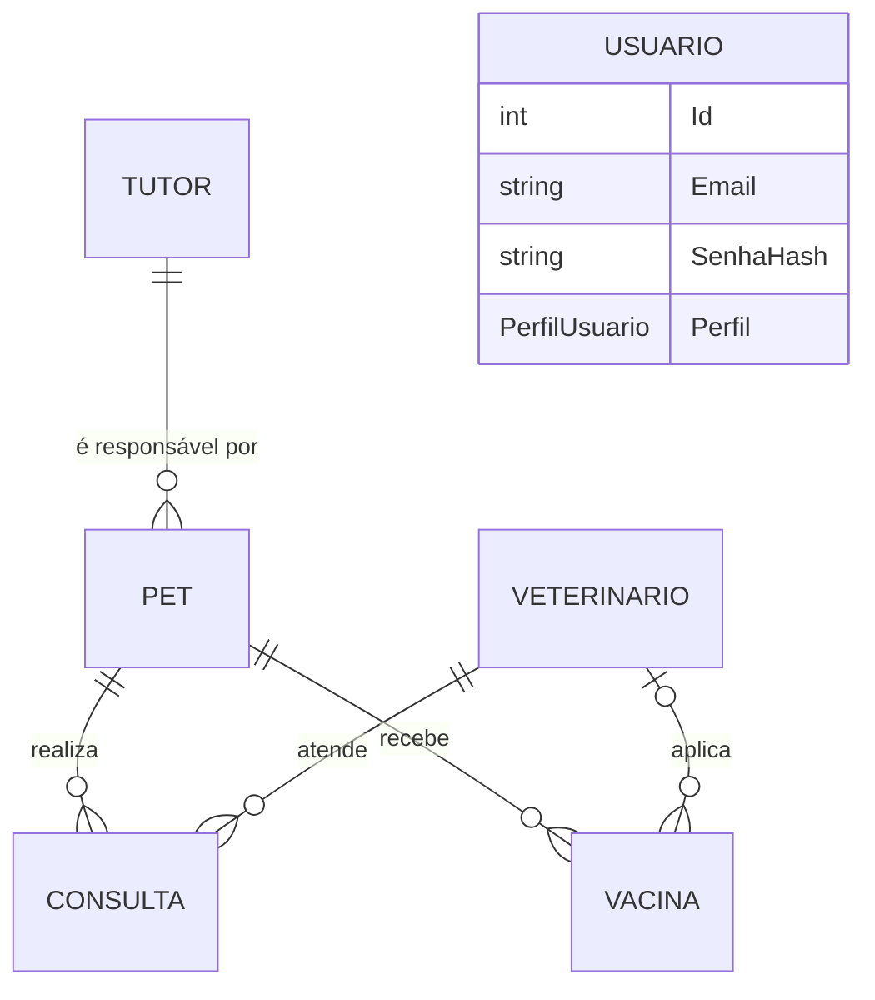
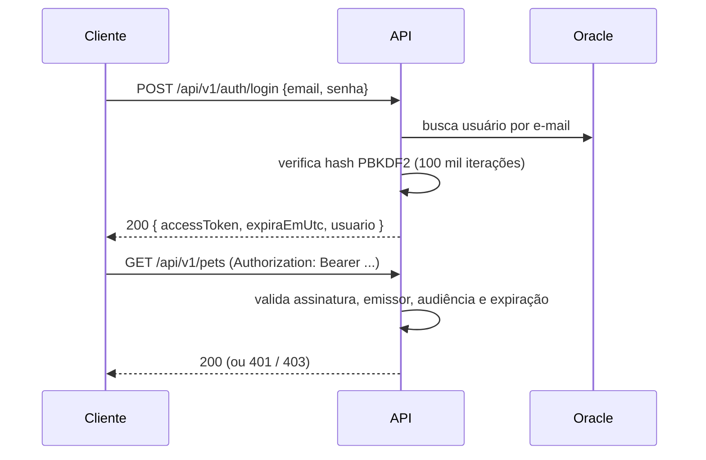

# Clyvo Pet Care API

API REST para acompanhamento contínuo da jornada de saúde de cachorros — tutores, pets, veterinários, consultas, carteira de vacinação e motor preventivo de lembretes. Construída no Challenge FIAP 2026 em parceria com a Clyvo VET.

[](https://github.com/PedroBiasolli/Clyvo_Api/actions/workflows/ci.yml)
[](#testes-automatizados)
[](#testes-automatizados)
[](https://dotnet.microsoft.com/)
[](https://learn.microsoft.com/ef/core/)
[](https://www.oracle.com/database/)
[](https://www.mongodb.com/)
[](https://jwt.io/)
[](https://swagger.io/)
[](https://serilog.net/)
[](https://opentelemetry.io/)
[](https://xunit.net/)

## Integrantes — 2TDSPO

| Nome | RM |
|---|---|
| Pedro Pereira Biasolli da Fonseca | RM562521 |
| Rodrigo Tiezzi | RM562975 |
| Bruno Zanateli | RM563736 |
| Christian Freitas | RM566098 |
| Matheus Enrico | RM562532 |

---

## Sumário

1. [O problema](#o-problema)
2. [Sprint 4 — onde cada requisito está](#sprint-4--onde-cada-requisito-está)
3. [Arquitetura](#arquitetura)
4. [Modelo de domínio e regras de negócio](#modelo-de-domínio-e-regras-de-negócio)
5. [API RESTful](#api-restful)
6. [Autenticação e autorização (JWT)](#autenticação-e-autorização-jwt)
7. [Persistência: Oracle + MongoDB](#persistência-oracle--mongodb)
8. [Monitoramento e observabilidade](#monitoramento-e-observabilidade)
9. [Testes automatizados](#testes-automatizados)
10. [Como executar](#como-executar)
11. [Roteiro de demonstração](#roteiro-de-demonstração)
12. [Decisões técnicas](#decisões-técnicas)

---

## O problema

Hoje o tutor só procura o veterinário quando algo dá errado: sintoma agudo, emergência ou aquela vacina lembrada tarde demais. A jornada fica cheia de buracos — tratamento abandonado, dose esquecida, agravamento evitável, vínculo frágil com a clínica.

A Clyvo Pet Care inverte essa lógica: a clínica passa a ter visão completa do que cada pet precisa, e o tutor recebe o lembrete certo na hora certa. Dois campos são o coração disso — `Consulta.ProximoRetorno` e `Vacina.DataProximaDose` — e alimentam os endpoints do motor preventivo (`/consultas/retornos-proximos/{dias}`, `/vacinas/atrasadas`, `/vacinas/proximas/{dias}`).

---

## Sprint 4 — onde cada requisito está

| Requisito | Pts | Como foi atendido | Onde ver |
|---|---|---|---|
| **Clean Architecture com separação de camadas** | 30 | 4 projetos com regra de dependência garantida pelo compilador: `Domain` ← `Application` ← `Infrastructure` / `Api` | [`src/`](src) · [Arquitetura](#arquitetura) |
| **SOLID e Clean Code** | | Domínio rico (setters privados, fábricas validadas), serviços pequenos e coesos, interfaces segregadas, dependências por abstração | [tabela SOLID](#solid-e-clean-code-na-prática) |
| **Injeção de Dependência** | | Cada camada expõe seu `AddXxx()`; `Program.cs` é só composição | `Application/DependencyInjection.cs`, `Infrastructure/DependencyInjection.cs`, `Api/Configuration/*` |
| **Tratamento global de exceções** | | `IExceptionHandler` + ProblemDetails (RFC 7807) com `traceId` e `correlationId`; controllers sem `try/catch` | `Api/ExceptionHandling/GlobalExceptionHandler.cs` |
| **Swagger/OpenAPI atualizado** | 20 | XML docs de controllers e DTOs, esquema Bearer, cadeado só nos endpoints protegidos, respostas 4xx/5xx documentadas | `/swagger` · `Api/Configuration/SwaggerConfiguration.cs` |
| **Paginação, ordenação e filtros** | | `pagina`, `tamanhoPagina`, `ordenarPor` (enum validado), `direcao` + filtros por recurso | [Listagens](#paginação-ordenação-e-filtros) |
| **HATEOAS** | | Links em todos os recursos (`self`, `atualizar`, `remover` e relações) e na paginação (`primeira`, `anterior`, `próxima`, `última`) | [HATEOAS](#hateoas) · `Api/Hateoas/*` |
| **Autenticação e Autorização JWT** | | Login com hash PBKDF2, JWT HS256, 3 perfis e 3 políticas | [JWT](#autenticação-e-autorização-jwt) |
| **EF Core + migrations (Oracle)** | 20 | `InitialCreate` + `AdicionarUsuarios` (nova nesta sprint) | `Infrastructure/Persistence/Migrations` |
| **MongoDB para operações NoSQL** | | Trilha de auditoria: inserção, consulta filtrada/paginada, busca por id e **aggregation pipeline** | `Infrastructure/NoSql/*` · `/api/v1/auditoria` |
| **Repository concreto** | | `RepositoryBase<T>` + 6 repositórios EF + repositório Mongo + Unit of Work | `Infrastructure/Persistence/Repositories` |
| **Health Checks** | 20 | `/health`, `/health/live`, `/health/ready` — self, Oracle e MongoDB | [Health checks](#health-checks) |
| **Logging estruturado** | | Serilog (console + arquivo JSON) com CorrelationId, usuário, máquina, thread | [Logging](#logging-estruturado--serilog) |
| **Testes unitários e de integração (AAA)** | | **182 testes, todos passando**: 131 casos unitários + 51 de integração com JWT real | [Testes](#testes-automatizados) |
| **Cobertura de Domínio e Aplicação** | | **Domínio 98,1% · Aplicação 96,6%** de linhas (Coverlet + ReportGenerator); o CI falha abaixo de 70% | `.github/workflows/ci.yml` |
| **Documentação e README final** | 10 | Este README + Swagger + `.http` de demonstração + scripts SQL comentados | — |

---

## Arquitetura

### Camadas e regra de dependência

```mermaid
flowchart LR
    subgraph Api["Clyvo.PetCare.Api — Apresentação"]
        C[Controllers + HATEOAS]
        EH[GlobalExceptionHandler]
        SEC[JWT + Políticas]
    end
    subgraph Infra["Clyvo.PetCare.Infrastructure"]
        EF[EF Core / Oracle<br/>Repositórios + UoW + Migrations]
        MG[MongoDB<br/>Auditoria]
        JWT[JWT + PBKDF2]
    end
    subgraph App["Clyvo.PetCare.Application — Casos de uso"]
        S[Services]
        D[DTOs + Mapeamentos]
        AB[Abstrações<br/>IGeradorToken, IHashSenha, IUsuarioAtual]
    end
    subgraph Dom["Clyvo.PetCare.Domain — Núcleo"]
        E[Entidades ricas]
        R[Contratos de repositório<br/>IUnitOfWork]
        Q[Query Objects / Filtros]
    end

    Api --> App
    Api -. composition root .-> Infra
    Infra --> App
    App --> Dom
```



As setas apontam sempre para dentro. O **Domínio não referencia nada** — nem EF, nem ASP.NET. A **Aplicação** só conhece o Domínio e abstrações; EF Core, MongoDB e JWT entram pelas interfaces (`IRepository`, `IUnitOfWork`, `IAuditoriaRepository`, `IGeradorToken`, `IHashSenha`), implementadas na **Infraestrutura**. A **Api** referencia a Infraestrutura apenas para registrar o DI.

### Estrutura

```
DotNet_Challenge/
├── src/
│   ├── Clyvo.PetCare.Domain/            # zero dependências externas
│   │   ├── Common/          EntityBase, DomainGuard (cláusulas de guarda), ResultadoPaginado
│   │   ├── Entities/        Tutor, Pet, Veterinario, Consulta, Vacina, Usuario, RegistroAuditoria
│   │   ├── Enums/           Porte, Sexo, Tipo/Status de consulta, PerfilUsuario, AcaoAuditoria
│   │   ├── Exceptions/      DomainException
│   │   ├── Queries/         Filtros (Query Objects) + enums de ordenação
│   │   └── Repositories/    IRepository<T>, repositórios específicos, IUnitOfWork, IAuditoriaRepository
│   │
│   ├── Clyvo.PetCare.Application/
│   │   ├── Abstractions/    IUsuarioAtual, IGeradorToken, IHashSenha
│   │   ├── DTOs/            entrada (Criar/Atualizar), saída (Response com Links), Query DTOs
│   │   ├── Exceptions/      RecursoNaoEncontrado, Conflito, RegraDeNegocio, CredenciaisInvalidas
│   │   ├── Mappings/        entidade ↔ DTO, query string ↔ filtro
│   │   └── Services/        casos de uso (Tutor, Pet, Veterinario, Consulta, Vacina, Auth, Auditoria)
│   │
│   ├── Clyvo.PetCare.Infrastructure/
│   │   ├── Persistence/     AppDbContext, Mappings (Fluent API), Repositories, UnitOfWork, Migrations, Seed
│   │   ├── NoSql/           MongoDbContext, AuditoriaDocument, AuditoriaRepository, índices
│   │   ├── Security/        JwtGeradorToken, HashSenhaPbkdf2, JwtSettings
│   │   └── HealthChecks/    MongoDbHealthCheck
│   │
│   └── Clyvo.PetCare.Api/
│       ├── Controllers/     7 controllers finos (herdam ApiControllerBase)
│       ├── Hateoas/         ILinkService (LinkGenerator), QueryStringHelper
│       ├── ExceptionHandling/  GlobalExceptionHandler → ProblemDetails
│       ├── Security/        políticas por perfil, IUsuarioAtual a partir das claims
│       ├── Middlewares/     CorrelationIdMiddleware
│       ├── Configuration/   Swagger, JWT, Serilog/OpenTelemetry/HealthChecks, pipeline
│       └── Program.cs       composition root (≈ 20 linhas úteis)
│
├── tests/
│   ├── Clyvo.PetCare.UnitTests/         domínio, serviços (Moq), mapeamentos, handler, controller
│   └── Clyvo.PetCare.IntegrationTests/  pipeline HTTP completo com WebApplicationFactory + JWT real
│
├── scripts/                 DDL Oracle, seed (inclui usuários) e cleanup
├── docker-compose.yml       MongoDB + mongo-express
├── coverlet.runsettings     configuração de cobertura
└── .github/workflows/ci.yml build + testes + cobertura mínima
```

### SOLID e Clean Code na prática

| Princípio | Onde aparece |
|---|---|
| **S** — Responsabilidade única | Controller só traduz HTTP; serviço orquestra o caso de uso; entidade guarda as regras; repositório só persiste; `GlobalExceptionHandler` só traduz exceções; `LinkService` só gera URLs. |
| **O** — Aberto/fechado | Novos agregados reutilizam `RepositoryBase<T>` sobrescrevendo apenas `ComRelacionamentos`; nova exceção = uma linha na tabela de `Classificar`. |
| **L** — Substituição de Liskov | Todos os repositórios são intercambiáveis pelos contratos; nos testes de integração o `AuditoriaRepository` (Mongo) é trocado por um em memória sem alterar nenhum serviço. |
| **I** — Segregação de interfaces | Auditoria separada em `IAuditoriaRegistrador` (escrita, usada pelos serviços) e `IAuditoriaConsultaService` (leitura, usada pelo controller). |
| **D** — Inversão de dependência | A Aplicação depende de `IUnitOfWork`, `IGeradorToken`, `IHashSenha`, `IUsuarioAtual` — nunca de EF, JWT ou `HttpContext`. |
| **Clean Code** | Nomes de domínio em português consistentes; métodos curtos; nenhuma entidade exposta pela API; sem *magic numbers* (constantes `TamanhoMaximo`, `JanelaPreventiva`); `CancellationToken` de ponta a ponta. |

---

## Modelo de domínio e regras de negócio



As entidades têm **setters privados** e só mudam por métodos que protegem as invariantes (`Tutor.Criar`, `Pet.Atualizar`, `Consulta.Agendar`...). Regras implementadas:

| Regra | Onde | HTTP |
|---|---|---|
| CPF normalizado para 11 dígitos (aceita pontuação) e único | `Tutor` / `TutorService` | 422 / 409 |
| UF com 2 letras, e-mail válido, tamanhos máximos | `DomainGuard` | 422 |
| Data de nascimento do pet e de aplicação da vacina não podem ser futuras | `Pet`, `Vacina` | 422 |
| Peso entre 0,1 e 120 kg; porte/sexo/tipo/status precisam existir no enum | `Pet`, `Consulta` | 422 |
| Microchip único entre pets | `PetService` | 409 |
| Veterinário inativo não recebe agendamento | `Consulta.Agendar` | 422 |
| Consulta **Realizada** exige diagnóstico; **Cancelada** não é reaberta | `Consulta.Atualizar` | 422 |
| Retorno posterior à consulta; próxima dose posterior à aplicação; valor ≥ 0 | `Consulta`, `Vacina` | 422 |
| Consulta realizada não é removida (faz parte do prontuário) | `Consulta.GarantirQuePodeSerRemovida` | 422 |
| Tutor com pets, pet com histórico e veterinário com consultas não são removidos | serviços | 422 |

---

## API RESTful

Todas as rotas ficam sob `/api/v1`. Leituras exigem autenticação; escrita e remoção dependem do perfil.

| Recurso | Endpoints | Escrita | Remoção |
|---|---|---|---|
| **Auth** `/auth` | `POST login` (público) · `GET me` · `POST usuarios` · `GET usuarios/{id}` | Admin | — |
| **Tutores** `/tutores` | `GET` · `GET {id}` · `GET cpf/{cpf}` · `POST` · `PUT {id}` · `DELETE {id}` | Admin, Veterinário, Atendente | Admin |
| **Pets** `/pets` | `GET` · `GET {id}` · `GET tutor/{tutorId}` · `GET microchip/{n}` · `POST` · `PUT` · `DELETE` | Admin, Veterinário, Atendente | Admin |
| **Veterinários** `/veterinarios` | `GET` · `GET {id}` · `GET crmv/{crmv}` · `POST` · `PUT` · `DELETE` | Admin | Admin |
| **Consultas** `/consultas` | `GET` · `GET {id}` · `GET pet/{petId}` · `GET retornos-proximos/{dias}` · `POST` · `PUT` · `DELETE` | agendar: todos · evoluir: Admin, Veterinário | Admin |
| **Vacinas** `/vacinas` | `GET` · `GET {id}` · `GET pet/{petId}` · `GET atrasadas` · `GET proximas/{dias}` · `POST` · `PUT` · `DELETE` | Admin, Veterinário | Admin |
| **Auditoria** `/auditoria` | `GET` · `GET {id}` · `GET resumo` | — | somente Admin lê |

São **41 endpoints de negócio** + `/health`, `/health/live`, `/health/ready` e `/metrics`.

### Paginação, ordenação e filtros

Todas as listagens aceitam `pagina` (≥ 1), `tamanhoPagina` (1–100), `ordenarPor` e `direcao` (`Asc`/`Desc`). `ordenarPor` é um enum por recurso — valores inválidos retornam **400** já no model binding, e a ordenação sempre desempata por `Id` para a paginação ser estável.

| Recurso | Filtros | `ordenarPor` (padrão em negrito) |
|---|---|---|
| Tutores | `nome`, `cidade` | **Nome**, Cidade, DataCadastro |
| Pets | `nome`, `raca`, `porte`, `tutorId` | **Nome**, Raca, DataNascimento, PesoKg, DataCadastro |
| Veterinários | `nome`, `especialidade`, `ativo` | **Nome**, Especialidade, DataCadastro |
| Consultas | `tipo`, `status`, `petId`, `veterinarioId`, `dataInicio`, `dataFim` | **DataHora** (desc), Tipo, Status, ProximoRetorno |
| Vacinas | `nome`, `petId` | **DataAplicacao** (desc), DataProximaDose, Nome |
| Auditoria | `entidade`, `entidadeId`, `acao`, `usuario`, `dataInicio`, `dataFim` | data (desc) |

```http
GET /api/v1/pets?porte=Grande&ordenarPor=PesoKg&direcao=Desc&pagina=1&tamanhoPagina=10
```

### HATEOAS

Cada recurso traz as ações possíveis a partir dele; as páginas trazem a navegação **preservando filtros e ordenação**:

```json
{
  "itens": [
    {
      "id": 1,
      "nome": "Thor",
      "porte": "Grande",
      "tutorId": 1,
      "tutorNome": "Mariana Souza",
      "links": [
        { "href": "http://localhost:5000/api/v1/pets/1",          "rel": "self",      "metodo": "GET" },
        { "href": "http://localhost:5000/api/v1/pets/1",          "rel": "atualizar", "metodo": "PUT" },
        { "href": "http://localhost:5000/api/v1/pets/1",          "rel": "remover",   "metodo": "DELETE" },
        { "href": "http://localhost:5000/api/v1/tutores/1",       "rel": "tutor",     "metodo": "GET" },
        { "href": "http://localhost:5000/api/v1/consultas/pet/1", "rel": "consultas", "metodo": "GET" },
        { "href": "http://localhost:5000/api/v1/vacinas/pet/1",   "rel": "vacinas",   "metodo": "GET" }
      ]
    }
  ],
  "pagina": 1,
  "tamanhoPagina": 10,
  "totalRegistros": 23,
  "totalPaginas": 3,
  "temPaginaAnterior": false,
  "temProximaPagina": true,
  "links": [
    { "href": "http://localhost:5000/api/v1/pets?porte=Grande&ordenarPor=PesoKg&direcao=Desc&pagina=1&tamanhoPagina=10", "rel": "self", "metodo": "GET" },
    { "href": "...pagina=1...", "rel": "primeira-pagina", "metodo": "GET" },
    { "href": "...pagina=2...", "rel": "proxima-pagina",  "metodo": "GET" },
    { "href": "...pagina=3...", "rel": "ultima-pagina",   "metodo": "GET" }
  ]
}
```

As URLs são geradas pelo `LinkGenerator` do roteamento — nunca concatenadas à mão — então continuam corretas se as rotas mudarem.

### Erros padronizados (ProblemDetails — RFC 7807)

O `GlobalExceptionHandler` é o único lugar que traduz exceções em HTTP:

| Exceção | Status |
|---|---|
| Validação do DTO (DataAnnotations) | **400** `ValidationProblemDetails` |
| `CredenciaisInvalidasException` / token ausente ou inválido | **401** |
| Perfil sem permissão | **403** |
| `RecursoNaoEncontradoException` / rota inexistente | **404** |
| `ConflitoException` (CPF, CRMV, e-mail, microchip duplicados; violação de integridade no banco) | **409** |
| `DomainException` / `RegraDeNegocioException` | **422** |
| Qualquer outra | **500** (sem detalhes internos fora de Development) |

```json
{
  "type": "https://httpstatuses.io/422",
  "title": "Regra de negócio violada",
  "status": 422,
  "detail": "Consultas realizadas exigem o registro do diagnóstico.",
  "instance": "/api/v1/consultas/1",
  "traceId": "00-6f1c...-01",
  "correlationId": "8b0c6c0f2b2f4f1e9e1a0e4f5d6c7b8a"
}
```

---

## Autenticação e autorização (JWT)



- **Senhas**: nunca armazenadas — apenas o hash PBKDF2-HMAC-SHA512 do ASP.NET Core Identity.
- **Token**: HS256 com `sub`, `email`, `name`, `role` e `jti`; validade configurável (`Jwt:ExpiracaoMinutos`, padrão 120 min). A chave precisa ter ≥ 256 bits — a API valida isso na inicialização.
- **Perfis e políticas**:

| Política | Perfis | Aplicada em |
|---|---|---|
| `Cadastro` | Admin, Veterinário, Atendente | criar/editar tutores e pets, agendar consultas |
| `Clinica` | Admin, Veterinário | evoluir consulta, registrar/corrigir vacinas |
| `Administracao` | Admin | remoções, veterinários, usuários, auditoria |

- **Primeiro acesso**: na subida, a API cria o administrador definido em `SeedAdmin` (`admin@clyvo.com.br` / `Clyvo@2026`) se ele ainda não existir.
- **No Swagger**: faça o login, copie o `accessToken`, clique em **Authorize** e cole só o token. O Swagger mostra cadeado apenas nos endpoints protegidos.

---

## Persistência: Oracle + MongoDB

### Relacional — EF Core 8 + Oracle 19c

- Mapeamento 100% via **Fluent API** (`Persistence/Mappings`) — o domínio não tem atributos de banco.
- **Migrations versionadas**:

| Migration | Conteúdo |
|---|---|
| `20260524150903_InitialCreate` | `TB_TUTOR`, `TB_PET`, `TB_VETERINARIO`, `TB_CONSULTA`, `TB_VACINA`, índices e FKs |
| `20261030150000_AdicionarUsuarios` | `TB_USUARIO` com índice único em `DS_EMAIL` (Sprint 4) |

- **Repository + Unit of Work**: `RepositoryBase<T>` implementa o CRUD genérico; cada repositório concreto adiciona consultas do seu agregado (filtros, ordenação, paginação, `Include`s). Leituras de listagem usam `AsNoTracking`. O `UnitOfWork` confirma tudo numa transação e converte `DbUpdateException` em **409**.

### NoSQL — MongoDB (trilha de auditoria)

Toda criação, alteração, remoção e login gera um documento na coleção `auditoria` — com quem fez, quando, o `correlationId` da requisição e o **snapshot do recurso** como subdocumento livre:

```json
{
  "_id": { "$oid": "6720f0c2a1b2c3d4e5f60718" },
  "entidade": "Consulta",
  "entidadeId": "12",
  "acao": "Atualizacao",
  "usuario": "ana.lima@clyvo.com.br",
  "dataHoraUtc": { "$date": "2026-10-30T15:42:10.512Z" },
  "correlationId": "8b0c6c0f2b2f4f1e9e1a0e4f5d6c7b8a",
  "dados": { "id": 12, "status": "Realizada", "diagnostico": "Otite leve", "proximoRetorno": "2026-11-14T09:00:00" }
}
```

Por que NoSQL aqui: é um log *append-only*, de alto volume, cujo formato varia por entidade — o caso clássico de documento flexível. O Oracle fica com o que exige integridade referencial.

| Operação Mongo | Endpoint |
|---|---|
| `InsertOne` | automático em cada escrita |
| `Find` com filtros, `Sort`, `Skip`/`Limit` e `CountDocuments` | `GET /api/v1/auditoria` |
| `Find` por `_id` | `GET /api/v1/auditoria/{id}` |
| **Aggregation** (`$match` → `$group` → `$sort`) | `GET /api/v1/auditoria/resumo` |

Índices (`entidade+entidadeId`, `dataHoraUtc`, `usuario`) são criados na inicialização. A gravação da auditoria é **tolerante a falhas**: se o Mongo cair, a operação de negócio (já confirmada no Oracle) não é desfeita — a falha vai para o log e o health check marca o MongoDB como `Degraded`.

---

## Monitoramento e observabilidade

### Health checks

| Endpoint | Uso | Verifica |
|---|---|---|
| `GET /health` | visão completa | `self` + `oracle-database` + `mongodb` |
| `GET /health/live` | liveness probe | apenas o processo (`self`) |
| `GET /health/ready` | readiness probe | Oracle (**Unhealthy** se cair) e MongoDB (**Degraded** se cair) |

```json
{
  "status": "Healthy",
  "totalDuration": "00:00:00.0241",
  "entries": {
    "self":            { "status": "Healthy", "description": "API respondendo" },
    "oracle-database": { "status": "Healthy" },
    "mongodb":         { "status": "Healthy", "description": "MongoDB respondendo ao ping." }
  }
}
```

### Logging estruturado — Serilog

- **Console** legível para desenvolvimento e **arquivo diário em JSON compacto** (`logs/clyvo-api-AAAAMMDD.log`, 14 dias de retenção) pronto para Elastic, Loki ou Seq.
- Toda linha carrega `CorrelationId`, `MachineName`, `ThreadId` e `Application`; o log de requisição inclui método, rota, status, duração e usuário.
- Os serviços registram eventos de negócio com propriedades estruturadas, por exemplo: `Consulta {ConsultaId} atualizada ({StatusAnterior} → {StatusAtual})`.
- O header `X-Correlation-Id` é aceito do cliente (ou gerado), devolvido na resposta e gravado nos logs, nos ProblemDetails e na auditoria — dá para seguir uma requisição de ponta a ponta.

### Tracing e métricas — OpenTelemetry

Instrumentação de ASP.NET Core, HttpClient, EF Core, runtime e processo. Traces exportados para o console; métricas no formato **Prometheus** em `GET /metrics`.

---

## Testes automatizados

Padrão **AAA** (Arrange, Act, Assert) e nomenclatura `Metodo_Cenario_ResultadoEsperado` em todos os testes.

| Projeto | Métodos | O que cobre |
|---|---|---|
| `Clyvo.PetCare.UnitTests` | **105** (131 casos com `Theory`) | Domínio (todas as regras das entidades, guardas, filtros), serviços de aplicação com Moq (sucesso, 404, 409, 422, auditoria, Unit of Work), mapeamentos, `GlobalExceptionHandler`, controller com HATEOAS e `QueryStringHelper` |
| `Clyvo.PetCare.IntegrationTests` | **51** | Pipeline HTTP completo com `WebApplicationFactory`: login JWT real, 401/403 por perfil, validação 400, ProblemDetails, paginação/ordenação/filtros, links HATEOAS, jornada clínica (agendar → evoluir → retorno → vacinas), auditoria, health checks, métricas, correlation id e Swagger |

Os testes de integração **não dependem de Oracle nem de MongoDB**: a fábrica troca o Oracle por EF Core InMemory e o repositório Mongo por um em memória — todo o resto (JWT, políticas, middlewares, handler) é o código de produção.

```bash
dotnet test                                              # tudo
dotnet test tests/Clyvo.PetCare.UnitTests                # só unitários
dotnet test tests/Clyvo.PetCare.IntegrationTests         # só integração

# cobertura (Domínio, Aplicação, Infraestrutura e Api; migrations excluídas)
dotnet test --settings coverlet.runsettings --collect:"XPlat Code Coverage" --results-directory ./TestResults
dotnet tool install -g dotnet-reportgenerator-globaltool
reportgenerator -reports:"TestResults/**/coverage.cobertura.xml" -targetdir:coverage -reporttypes:Html
```

O workflow `.github/workflows/ci.yml` roda build, todos os testes e gera o relatório de cobertura a cada push; o job **falha se a cobertura de linhas de Domínio ou de Aplicação ficar abaixo de 70%**.

### Resultado no CI (GitHub Actions)

| Verificação | Resultado |
|---|---|
| Build da solução | ✅ 0 erros · 0 avisos |
| Testes unitários | ✅ 131 / 131 |
| Testes de integração | ✅ 51 / 51 |
| Cobertura de linhas — **Domínio** | ✅ **98,1%** |
| Cobertura de linhas — **Aplicação** | ✅ **96,6%** |

O relatório HTML completo fica disponível como artefato (`cobertura-e-resultados`) em cada execução da aba **Actions**.

---

## Como executar

### Pré-requisitos

- .NET 8 SDK
- Acesso ao Oracle da FIAP (ou um Oracle 19c local)
- Docker (para o MongoDB) — ou um MongoDB local/Atlas

### Passo a passo

```bash
git clone https://github.com/PedroBiasolli/Clyvo_Api.git
cd Clyvo_Api

# 1. MongoDB (auditoria) + painel em http://localhost:8081
docker compose up -d

# 2. Connection string do Oracle sem expor a senha no Git
cd src/Clyvo.PetCare.Api
dotnet user-secrets init
dotnet user-secrets set "ConnectionStrings:OracleFiap" "Data Source=(DESCRIPTION=(ADDRESS=(PROTOCOL=TCP)(HOST=oracle.fiap.com.br)(PORT=1521))(CONNECT_DATA=(SID=ORCL)));User Id=RMXXXXX;Password=SUA_SENHA;"
cd ../..

# 3. Migrations no Oracle (as duas: InitialCreate + AdicionarUsuarios)
dotnet tool install --global dotnet-ef        # se ainda não tiver
dotnet ef database update --project src/Clyvo.PetCare.Infrastructure --startup-project src/Clyvo.PetCare.Api

# 4. Subir a API
dotnet run --project src/Clyvo.PetCare.Api
```

A API sobe em `http://localhost:5000` e a raiz redireciona para o **Swagger** (`/swagger`). No Visual Studio, abra `Clyvo.PetCare.sln`, defina `Clyvo.PetCare.Api` como projeto de inicialização e pressione F5.

> **Já aplicou a migration da Sprint 3?** Basta rodar o `database update` de novo: só a `AdicionarUsuarios` será aplicada.
> **Prefere SQL puro?** Os scripts em [`scripts/`](scripts) criam o mesmo schema e incluem usuários de demonstração.

### Configuração (`appsettings.json`)

| Seção | Para quê |
|---|---|
| `ConnectionStrings:OracleFiap` | Oracle (use *user-secrets* para a senha) |
| `MongoDb` | `ConnectionString`, `Database`, `ColecaoAuditoria`, `TimeoutSegundos` |
| `Jwt` | `Issuer`, `Audience`, `ChaveSecreta` (≥ 32 bytes), `ExpiracaoMinutos` |
| `SeedAdmin` | administrador criado automaticamente na primeira subida |
| `Serilog` | níveis, sinks e formatos de log |

---

## Roteiro de demonstração

O arquivo [`src/Clyvo.PetCare.Api/Clyvo.PetCare.Api.http`](src/Clyvo.PetCare.Api/Clyvo.PetCare.Api.http) tem todas as chamadas na ordem abaixo (abre direto no Visual Studio/VS Code):

1. `POST /auth/login` como admin → copiar o token → **Authorize** no Swagger.
2. Criar tutor (com CPF pontuado), pet e veterinário — observar os **links HATEOAS** nas respostas.
3. `GET /tutores?ordenarPor=DataCadastro&direcao=Desc&tamanhoPagina=5` — paginação, ordenação e links de navegação.
4. Agendar consulta; tentar marcá-la como **Realizada sem diagnóstico** → **422 ProblemDetails**.
5. Evoluir a consulta com diagnóstico e retorno → `GET /consultas/retornos-proximos/60`.
6. `GET /vacinas/atrasadas` — motor preventivo.
7. Logar como atendente e tentar `DELETE` → **403**.
8. `GET /auditoria?entidade=Consulta` e `GET /auditoria/resumo` — dados vindos do **MongoDB** (aggregation).
9. `GET /health`, `/health/ready` e `/metrics`; mostrar o `X-Correlation-Id` nos logs.

---

## Decisões técnicas

- **Domínio rico em vez de anêmico** — as regras moram na entidade e são testadas sem banco nem mock.
- **Exceções como fluxo de erro** — o serviço sempre devolve um DTO válido ou lança uma exceção semântica; o handler global decide o status HTTP. Resultado: controllers de uma linha por ação, sem `if (x is null) return NotFound()`.
- **Enums para `ordenarPor`** — validação automática, documentação automática no Swagger e nenhum risco de ordenar por coluna arbitrária.
- **Oracle para dados clínicos, MongoDB para auditoria** — cada banco no que faz melhor; a auditoria não pode derrubar a operação principal.
- **HATEOAS com `LinkGenerator`** — links gerados a partir das rotas reais, em URLs absolutas e minúsculas.
- **Testes de integração com JWT real** — nada de handler de autenticação falso: os testes exercitam emissão, validação e políticas exatamente como em produção.

### Próximos passos

- Exportar traces via OTLP para Jaeger/Grafana Tempo e alertas de SLO no Grafana.
- Refresh token e bloqueio após tentativas de login seguidas.
- Disparo real dos lembretes (e-mail/WhatsApp) a partir do motor preventivo.
- Dashboard analítico para clínicas (taxa de retorno, abandono de tratamento).

---

Challenge FIAP 2026 — Clyvo VET · 2TDSPO
