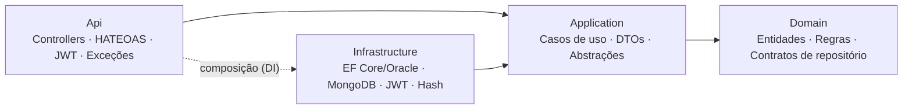
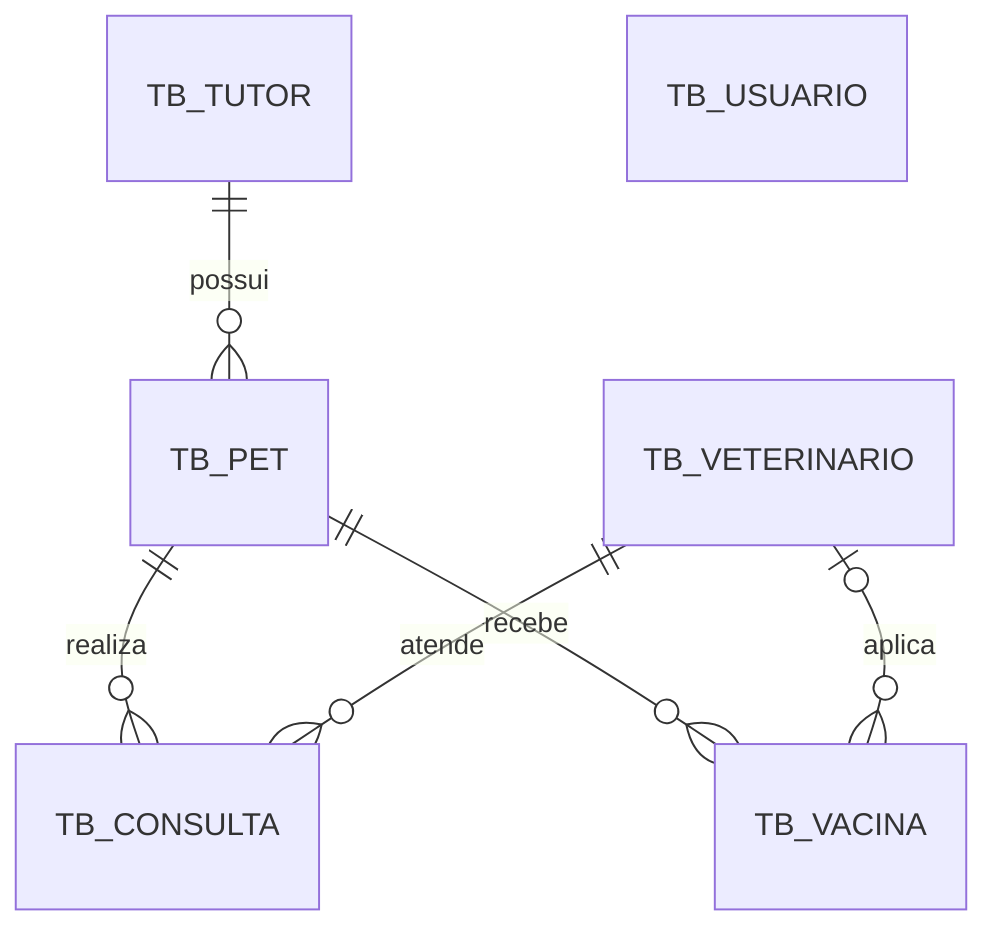

# Clyvo Pet Care API

API REST em .NET 8 para a continuidade do cuidado na saúde de cachorros: tutores, pets, veterinários, consultas, carteira de vacinação e lembretes preventivos (retornos e doses). Challenge FIAP 2026 — Clyvo VET.

[](https://github.com/PedroBiasolli/Clyvo_Api/actions/workflows/ci.yml)


## Integrantes — 2TDSPO

| Nome | RM |
|---|---|
| Pedro Pereira Biasolli da Fonseca | RM562521 |
| Rodrigo Tiezzi | RM562975 |
| Bruno Zanateli | RM563736 |
| Christian Freitas | RM566098 |
| Matheus Enrico | RM562532 |

## Sumário

1. [Requisitos da Sprint 4](#requisitos-da-sprint-4)
2. [Arquitetura e código](#1-arquitetura-e-código)
3. [API RESTful](#2-api-restful)
4. [Persistência de dados](#3-persistência-de-dados)
5. [Monitoramento, observabilidade e testes](#4-monitoramento-observabilidade-e-testes)
6. [Como executar](#como-executar)

---

## Requisitos da Sprint 4

| Requisito | Pts | Implementação | Onde está |
|---|---|---|---|
| Clean Architecture com separação de camadas | 30 | 4 projetos: Domain ← Application ← Infrastructure / Api | `src/` |
| Princípios SOLID e Clean Code | | Domínio rico, serviços coesos, interfaces segregadas, dependência de abstrações | [SOLID](#solid-e-clean-code) |
| Injeção de Dependência | | `AddApplication()`, `AddInfrastructure()` e configurações da Api | `*/DependencyInjection.cs`, `Api/Configuration` |
| Tratamento de exceções global | | `IExceptionHandler` + ProblemDetails (RFC 7807) | `Api/ExceptionHandling` |
| Swagger/OpenAPI atualizado | 20 | Comentários XML, esquema Bearer, respostas de erro documentadas | `/swagger` |
| Paginação, ordenação e filtros | | Em todas as listagens | [Listagens](#paginação-ordenação-e-filtros) |
| HATEOAS nos endpoints de consulta | | Links por recurso e de navegação entre páginas | `Api/Hateoas` |
| Autenticação e autorização JWT | | Login, 3 perfis e 3 políticas | `/api/v1/auth` |
| EF Core com migrations (Oracle) | 20 | `InitialCreate` + `AdicionarUsuarios` | `Infrastructure/Persistence/Migrations` |
| MongoDB para operações NoSQL | | Trilha de auditoria com consulta e aggregation | `Infrastructure/NoSql`, `/api/v1/auditoria` |
| Repositórios com padrão Repository | | `RepositoryBase<T>`, 6 repositórios EF, 1 MongoDB e Unit of Work | `Infrastructure/Persistence/Repositories` |
| Health Checks | 20 | `/health`, `/health/live`, `/health/ready` | `Api/Configuration/ObservabilidadeConfiguration.cs` |
| Logging estruturado | | Serilog com CorrelationId | `appsettings.json` (seção `Serilog`) |
| Testes unitários e de integração (AAA, xUnit) | | 134 unitários + 51 de integração, todos passando | `tests/` |
| Cobertura de Domínio e Aplicação | | Domínio **98,1%** · Aplicação **96,6%** | CI (`.github/workflows/ci.yml`) |
| Documentação e README final | 10 | Este README, Swagger e scripts SQL | — |

---

## 1. Arquitetura e código

### Camadas



| Projeto | Responsabilidade | Depende de |
|---|---|---|
| `Clyvo.PetCare.Domain` | Entidades com regras de negócio, exceção de domínio, filtros de consulta e contratos de repositório | nada |
| `Clyvo.PetCare.Application` | Casos de uso (serviços), DTOs, mapeamentos e abstrações (`IUnitOfWork`, `IGeradorToken`, `IHashSenha`, `IUsuarioAtual`) | Domain |
| `Clyvo.PetCare.Infrastructure` | EF Core + Oracle, repositórios, Unit of Work, migrations, MongoDB, JWT, hash de senha, seed e health check do MongoDB | Application |
| `Clyvo.PetCare.Api` | Controllers, HATEOAS, autenticação/autorização, tratamento de exceções, Swagger e observabilidade | Application (Infrastructure só para o DI) |

Como as camadas são projetos separados, o compilador impede que o Domínio ou a Aplicação usem EF Core, MongoDB ou ASP.NET.

### SOLID e Clean Code

| Princípio | Aplicação no projeto |
|---|---|
| Responsabilidade única | Controller traduz HTTP, serviço orquestra o caso de uso, entidade valida as regras, repositório persiste, `GlobalExceptionHandler` traduz erros |
| Aberto/fechado | Novos repositórios herdam `RepositoryBase<T>` e só definem seus `Include`s e consultas |
| Substituição de Liskov | Implementações trocáveis pelos contratos (nos testes, o repositório MongoDB é substituído por um em memória sem alterar os serviços) |
| Segregação de interfaces | Auditoria dividida em `IAuditoriaRegistrador` (escrita) e `IAuditoriaConsultaService` (leitura) |
| Inversão de dependência | A Aplicação depende só de interfaces; EF Core, MongoDB, JWT e `HttpContext` ficam nas camadas externas |
| Clean Code | Entidades com setters privados e métodos de fábrica validados, constantes em vez de números mágicos, nenhuma entidade exposta pela API, `CancellationToken` de ponta a ponta |

### Regras de negócio (no domínio)

| Regra | HTTP |
|---|---|
| CPF com 11 dígitos (aceita pontuação) e único; CRMV, e-mail de usuário e microchip únicos | 422 / 409 |
| Nascimento do pet e aplicação da vacina não podem ser datas futuras | 422 |
| Veterinário inativo não recebe agendamento | 422 |
| Consulta realizada exige diagnóstico; consulta cancelada não é reaberta | 422 |
| Retorno posterior à consulta; próxima dose posterior à aplicação; valor cobrado ≥ 0 | 422 |
| Não remove: consulta realizada, tutor com pets, pet com histórico, veterinário com consultas | 422 |

### Injeção de dependência

O `Program.cs` só faz a composição:

```csharp
builder.Services
    .AddApplication()                                              // casos de uso
    .AddInfrastructure(builder.Configuration, builder.Environment) // Oracle, MongoDB, JWT, hash
    .AddApresentacao()                                             // controllers, ProblemDetails, HATEOAS
    .AddSegurancaJwt()                                             // autenticação e autorização
    .AddDocumentacaoSwagger()                                      // OpenAPI
    .AddObservabilidade(builder.Environment);                      // health checks + OpenTelemetry
```

### Tratamento global de exceções

O `GlobalExceptionHandler` converte toda exceção em ProblemDetails (RFC 7807). Os controllers não têm `try/catch`.

| Situação | Status |
|---|---|
| Dados inválidos no corpo ou na query | 400 |
| Login inválido, token ausente ou expirado | 401 |
| Perfil sem permissão | 403 |
| Recurso ou rota inexistente | 404 |
| Registro duplicado ou violação de integridade | 409 |
| Regra de negócio violada | 422 |
| Erro inesperado (sem detalhes internos fora de Development) | 500 |

```json
{
  "type": "https://httpstatuses.io/422",
  "title": "Regra de negócio violada",
  "status": 422,
  "detail": "Consultas realizadas exigem o registro do diagnóstico.",
  "instance": "/api/v1/consultas/1",
  "traceId": "00-6f1c...-01",
  "correlationId": "8b0c6c0f2b2f4f1e9e1a0e4f5d6c7b8a"
}
```

---

## 2. API RESTful

Documentação interativa em **`/swagger`** (a raiz `/` redireciona para lá). Rotas sob `/api/v1`:

| Recurso | Endpoints |
|---|---|
| `auth` | `POST login` · `GET me` · `POST usuarios` · `GET usuarios/{id}` |
| `tutores` | `GET` · `GET {id}` · `GET cpf/{cpf}` · `POST` · `PUT {id}` · `DELETE {id}` |
| `pets` | `GET` · `GET {id}` · `GET tutor/{tutorId}` · `GET microchip/{microchip}` · `POST` · `PUT {id}` · `DELETE {id}` |
| `veterinarios` | `GET` · `GET {id}` · `GET crmv/{crmv}` · `POST` · `PUT {id}` · `DELETE {id}` |
| `consultas` | `GET` · `GET {id}` · `GET pet/{petId}` · `GET retornos-proximos/{dias}` · `POST` · `PUT {id}` · `DELETE {id}` |
| `vacinas` | `GET` · `GET {id}` · `GET pet/{petId}` · `GET atrasadas` · `GET proximas/{dias}` · `POST` · `PUT {id}` · `DELETE {id}` |
| `auditoria` | `GET` · `GET {id}` · `GET resumo` |

### Paginação, ordenação e filtros

Toda listagem aceita `pagina` (≥ 1), `tamanhoPagina` (1 a 100), `ordenarPor` e `direcao` (`Asc` ou `Desc`). Valores inválidos retornam 400.

| Recurso | Filtros | `ordenarPor` (padrão primeiro) |
|---|---|---|
| Tutores | `nome`, `cidade` | Nome, Cidade, DataCadastro |
| Pets | `nome`, `raca`, `porte`, `tutorId` | Nome, Raca, DataNascimento, PesoKg, DataCadastro |
| Veterinários | `nome`, `especialidade`, `ativo` | Nome, Especialidade, DataCadastro |
| Consultas | `tipo`, `status`, `petId`, `veterinarioId`, `dataInicio`, `dataFim` | DataHora (desc), Tipo, Status, ProximoRetorno |
| Vacinas | `nome`, `petId` | DataAplicacao (desc), DataProximaDose, Nome |
| Auditoria | `entidade`, `entidadeId`, `acao`, `usuario`, `dataInicio`, `dataFim` | data (desc) |

```http
GET /api/v1/pets?porte=Grande&ordenarPor=PesoKg&direcao=Desc&pagina=1&tamanhoPagina=10
```

### HATEOAS

Cada recurso traz suas ações e relações; cada página traz a navegação mantendo filtros e ordenação:

```json
{
  "itens": [
    {
      "id": 1,
      "nome": "Thor",
      "tutorId": 1,
      "links": [
        { "href": "http://localhost:5000/api/v1/pets/1",          "rel": "self",      "metodo": "GET" },
        { "href": "http://localhost:5000/api/v1/pets/1",          "rel": "atualizar", "metodo": "PUT" },
        { "href": "http://localhost:5000/api/v1/pets/1",          "rel": "remover",   "metodo": "DELETE" },
        { "href": "http://localhost:5000/api/v1/tutores/1",       "rel": "tutor",     "metodo": "GET" },
        { "href": "http://localhost:5000/api/v1/consultas/pet/1", "rel": "consultas", "metodo": "GET" },
        { "href": "http://localhost:5000/api/v1/vacinas/pet/1",   "rel": "vacinas",   "metodo": "GET" }
      ]
    }
  ],
  "pagina": 1,
  "tamanhoPagina": 10,
  "totalRegistros": 23,
  "totalPaginas": 3,
  "links": [
    { "href": "http://localhost:5000/api/v1/pets?porte=Grande&ordenarPor=PesoKg&direcao=Desc&pagina=1&tamanhoPagina=10", "rel": "self", "metodo": "GET" },
    { "href": "...&pagina=1...", "rel": "primeira-pagina", "metodo": "GET" },
    { "href": "...&pagina=2...", "rel": "proxima-pagina",  "metodo": "GET" },
    { "href": "...&pagina=3...", "rel": "ultima-pagina",   "metodo": "GET" }
  ]
}
```

### Autenticação e autorização (JWT)

1. `POST /api/v1/auth/login` com e-mail e senha devolve o `accessToken`.
2. No Swagger, clique em **Authorize** e cole o token.

As senhas são guardadas apenas como hash PBKDF2 (ASP.NET Core Identity). O token é HS256, com validade de 120 minutos. Leituras exigem apenas login; escrita depende do perfil:

| Política | Perfis | Uso |
|---|---|---|
| `Cadastro` | Admin, Veterinário, Atendente | cadastrar/editar tutores e pets, agendar consultas |
| `Clinica` | Admin, Veterinário | evoluir consultas, registrar vacinas |
| `Administracao` | Admin | remoções, veterinários, usuários e auditoria |

Na primeira execução a API cria o administrador **`admin@clyvo.com.br`** / **`Clyvo@2026`** (seção `SeedAdmin` do `appsettings.json`).

---

## 3. Persistência de dados

### Oracle — Entity Framework Core 8

- Mapeamento por Fluent API (`Infrastructure/Persistence/Mappings`).
- Migrations:

| Migration | Conteúdo |
|---|---|
| `20260524150903_InitialCreate` | `TB_TUTOR`, `TB_PET`, `TB_VETERINARIO`, `TB_CONSULTA`, `TB_VACINA` |
| `20261030150000_AdicionarUsuarios` | `TB_USUARIO` (autenticação) |

- Padrão Repository: `RepositoryBase<T>` com o CRUD genérico e repositórios concretos para Tutor, Pet, Veterinário, Consulta, Vacina e Usuário. A `UnitOfWork` confirma as alterações numa transação.



### MongoDB — trilha de auditoria

Cada criação, alteração, remoção e login gera um documento na coleção `auditoria`, com usuário, data, correlation id e um snapshot do registro:

```json
{
  "_id": { "$oid": "6720f0c2a1b2c3d4e5f60718" },
  "entidade": "Consulta",
  "entidadeId": "12",
  "acao": "Atualizacao",
  "usuario": "ana.lima@clyvo.com.br",
  "dataHoraUtc": { "$date": "2026-10-30T15:42:10.512Z" },
  "correlationId": "8b0c6c0f2b2f4f1e9e1a0e4f5d6c7b8a",
  "dados": { "id": 12, "status": "Realizada", "diagnostico": "Otite leve" }
}
```

| Operação MongoDB | Endpoint |
|---|---|
| `InsertOne` | automático em cada escrita |
| `Find` com filtros, ordenação, paginação e contagem | `GET /api/v1/auditoria` |
| `Find` por `_id` | `GET /api/v1/auditoria/{id}` |
| Aggregation (`$match`, `$group`, `$sort`) | `GET /api/v1/auditoria/resumo` |

Os índices da coleção são criados na inicialização. Se o MongoDB estiver fora do ar, a operação no Oracle não é desfeita: a falha vai para o log e o health check marca o MongoDB como `Degraded`.

---

## 4. Monitoramento, observabilidade e testes

### Health checks

| Endpoint | Verifica |
|---|---|
| `GET /health` | API, Oracle e MongoDB |
| `GET /health/live` | apenas a API (liveness) |
| `GET /health/ready` | Oracle e MongoDB (readiness) |

### Logging estruturado

Serilog com saída no console e em arquivo diário JSON (`logs/clyvo-api-AAAAMMDD.log`). Cada linha tem `CorrelationId`, máquina, thread e aplicação, e cada requisição registra método, rota, status, duração e usuário. O header `X-Correlation-Id` é devolvido em toda resposta e aparece nos logs, nos erros e na auditoria. Métricas no formato Prometheus em `GET /metrics` (OpenTelemetry).

### Testes (xUnit, padrão AAA)

| Projeto | Testes | Cobertura |
|---|---|---|
| `Clyvo.PetCare.UnitTests` | 134 | Regras do domínio, serviços com Moq, mapeamentos, tratamento de exceções, controller e HATEOAS |
| `Clyvo.PetCare.IntegrationTests` | 51 | Pipeline HTTP completo com `WebApplicationFactory` e JWT real: autenticação, permissões, validações, paginação, HATEOAS, fluxo clínico, auditoria e health checks |

Resultado no GitHub Actions (executado a cada push):

| Verificação | Resultado |
|---|---|
| Build | ✅ 0 erros · 0 avisos |
| Testes | ✅ 185 de 185 passando |
| Cobertura de linhas — Domínio | ✅ 98,1% |
| Cobertura de linhas — Aplicação | ✅ 96,6% |

O CI falha se a cobertura de Domínio ou de Aplicação ficar abaixo de 70%. Os testes de integração usam EF Core InMemory e um repositório de auditoria em memória, então não precisam de Oracle nem MongoDB.

```bash
dotnet test
dotnet test --settings coverlet.runsettings --collect:"XPlat Code Coverage"
```

---

## Como executar

**Pré-requisitos:** .NET 8 SDK, acesso ao Oracle da FIAP e Docker (para o MongoDB).

```bash
git clone https://github.com/PedroBiasolli/Clyvo_Api.git
cd Clyvo_Api

# 1. MongoDB
docker compose up -d

# 2. Connection string do Oracle (fora do Git)
dotnet user-secrets --project src/Clyvo.PetCare.Api set "ConnectionStrings:OracleFiap" "Data Source=(DESCRIPTION=(ADDRESS=(PROTOCOL=TCP)(HOST=oracle.fiap.com.br)(PORT=1521))(CONNECT_DATA=(SID=ORCL)));User Id=RMXXXXX;Password=SUA_SENHA;"

# 3. Migrations
dotnet tool install --global dotnet-ef
dotnet ef database update --project src/Clyvo.PetCare.Infrastructure --startup-project src/Clyvo.PetCare.Api

# 4. API
dotnet run --project src/Clyvo.PetCare.Api
```

Acesse **http://localhost:5000/swagger**. No Visual Studio, abra `Clyvo.PetCare.sln` e execute o projeto `Clyvo.PetCare.Api`.

| Configuração (`appsettings.json`) | Uso |
|---|---|
| `ConnectionStrings:OracleFiap` | conexão com o Oracle |
| `MongoDb` | conexão, banco e coleção da auditoria |
| `Jwt` | emissor, audiência, chave e validade do token |
| `SeedAdmin` | administrador criado na primeira execução |
| `Serilog` | níveis e destinos dos logs |

Alternativa às migrations: os scripts de [`scripts/`](scripts) criam o mesmo schema no Oracle. Exemplos prontos de requisições estão em `src/Clyvo.PetCare.Api/Clyvo.PetCare.Api.http`.

---

Challenge FIAP 2026 — Clyvo VET · 2TDSPO
